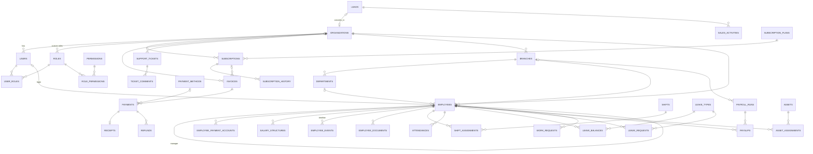
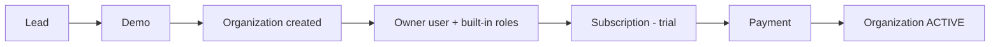
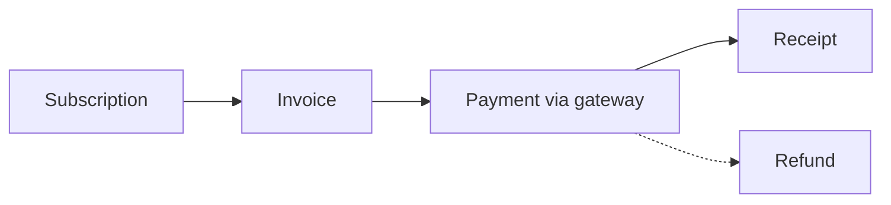
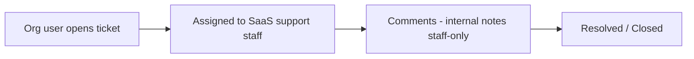
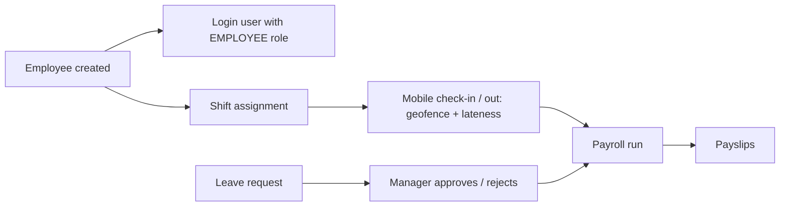

# mindHR

Multi-tenant SaaS for HR / workforce management. One SaaS company (Super Admin + SaaS staff) sells to many client
organizations; each organization is an isolated tenant with branches, employees, attendance, leave and payroll.

| Folder | Purpose |
|---|---|
| `backend/` | Spring Boot 4 API (Java 21, JPA/Hibernate, Postgres on Neon, JWT) |
| `frontend/` | React/Vite client (not scaffolded yet) |
| `mobile_app/` | Employee mobile app (placeholder) |

## Run

All commands from `backend/`. Create `backend/.env` first:

```properties
DB_URL=jdbc:postgresql://<host>/<db>?user=<user>&password=<password>&sslmode=require
JWT_SECRET=<base64 secret>
# optional
JWT_EXPIRATION_MS=3600000
SEED_ENABLED=true
SEED_ADMIN_EMAIL=admin@mindhr.local
SEED_ADMIN_PASSWORD=ChangeMe123!
```

**Docker Compose**
```bash
docker compose up --build -d
docker compose logs -f app
docker compose down
```

**Without Docker**
```bash
./mvnw spring-boot:run
./mvnw test
```

API: http://localhost:8080. On first start a `SUPER_ADMIN` is seeded from the `SEED_ADMIN_*` values; change the password
after you log in.

## API docs

- **Swagger UI:** http://localhost:8080/swagger-ui.html (OpenAPI JSON at `/v3/api-docs`). Call `POST /api/auth/login`,
  click **Authorize**, and paste the token yourself.
- **Postman:** import `backend/postman/mindhr.postman_collection.json` (214 requests, one folder per controller).
  Run `POST /api/auth/login`, then paste the token into the collection variable `token`. Nothing saves it automatically.
  Regenerate after API changes with `python postman/generate_postman.py` (from `backend/`).

## ER diagram

Platform side (SaaS company) and organization side (tenant data). Attributes are in
[backend/docs/er-diagram.md](backend/docs/er-diagram.md); this diagram shows relationships only.



Tenant rule: every organization-owned table has a non-null `organization_id` (`Tenant` base class). `USERS`, `ROLES`
and `ACTIVITY_LOGS` have a nullable one (null = platform level).

## Flows

**Onboarding (SaaS side)**


**Billing**


**Support**


**Employee, attendance and payroll**


Payroll rules: Friday off, 3 lates = 1 day deducted, no holiday calendar yet.

## Access model

- **What a user may do:** `Role` -> `Permission(module, action)`, enforced with `@PreAuthorize("hasAuthority('MODULE_ACTION')")`.
- **Which rows a user sees:** `Role.dataScope` = `PLATFORM`, `ORGANIZATION`, `BRANCH`, `TEAM` or `SELF` (widest scope wins).
  Scope, employee id and branch id are JWT claims, so changes apply at next login.
- **Built-in roles per organization:** `ORG_OWNER`, `HR_ADMIN`, `BRANCH_MANAGER`, `TEAM_LEAD`, `EMPLOYEE`.
- **SaaS staff** have no HR permissions, so they cannot read client HR data.
- **Plan limits:** `maxEmployees`, `maxBranches`, and feature gates (PAYROLL, ASSETS). An organization without a
  TRIAL / ACTIVE / GRACE_PERIOD subscription cannot add employees or branches.
