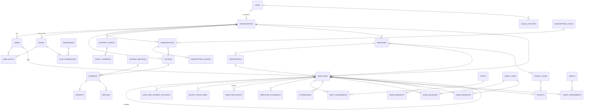
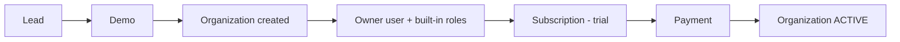
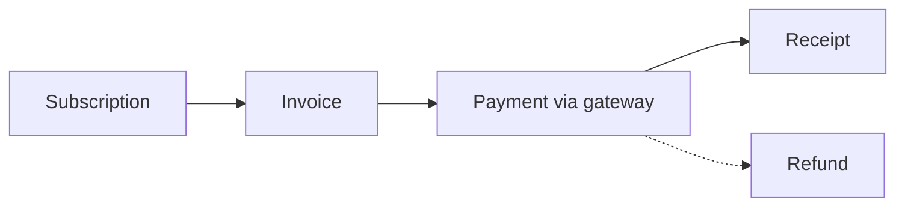
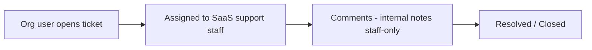
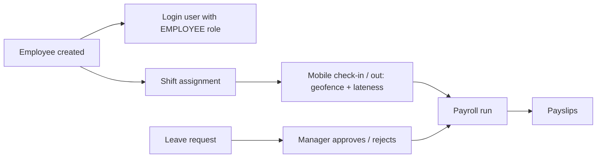

# mindHR

Multi-tenant SaaS for HR / workforce management. One SaaS company (Super Admin + SaaS staff) sells to many client
organizations; each organization is an isolated tenant with branches, employees, attendance, leave and payroll.

| Folder | Purpose |
|---|---|
| `backend/` | Spring Boot 4 API (Java 21, JPA/Hibernate, Postgres on Neon, JWT) |
| `frontend/` | React + Vite + TypeScript admin web app (platform screens and HR screens) |
| `mobile_app/` | Android employee app (Kotlin + Jetpack Compose): check-in/out, leave, payslips, requests, approvals |

**New here?** Read [docs/USER_MANUAL.md](docs/USER_MANUAL.md). It explains, step by step, what data to enter (plan,
organization, branch, employees, leave, shifts, payroll) so the web and mobile apps work.
Diagrams of users, roles and the main flows (check-in, leave, requests, payroll, sign-in): [docs/USER_FLOWS.md](docs/USER_FLOWS.md).
QA logins and test data for trying the apps: [docs/QA_CREDENTIALS.md](docs/QA_CREDENTIALS.md).

## Run

Backend commands run from `backend/`. Create `backend/.env` first:

```properties
DB_URL=jdbc:postgresql://<host>/<db>?user=<user>&password=<password>&sslmode=require
JWT_SECRET=<base64 secret>
# optional
JWT_EXPIRATION_MS=3600000
SEED_ENABLED=true
SEED_ADMIN_EMAIL=admin@mindhr.local
SEED_ADMIN_PASSWORD=ChangeMe123!
```

**Docker Compose**
```bash
docker compose up --build -d
docker compose logs -f app
docker compose down
```

**Without Docker**
```bash
./mvnw spring-boot:run
./mvnw test
python3 scripts/api_e2e_test.py   # end-to-end API test against the running backend (seeds "QA Test Org")
```

API: http://localhost:8080. On first start a `SUPER_ADMIN` is seeded from the `SEED_ADMIN_*` values; change the password
after you log in.

**Web app** (from `frontend/`, Node 22+)
```bash
npm install
npm run dev     # http://localhost:5173, proxies /api to http://localhost:8080
npm run build
```

**Android app** (from `mobile_app/`; needs JDK 21 and the Android SDK, e.g. from Android Studio)
```bash
./gradlew assembleDebug   # APK in app/build/outputs/apk/debug/
./gradlew installDebug    # install on a running emulator or a USB device
```

- The emulator reaches the backend at `http://10.0.2.2:8080/` (the default). For a real phone on the same Wi-Fi, build
  with your computer's IP: `./gradlew installDebug -PapiBaseUrl=http://192.168.1.10:8080/`.
- Sign in with an organization user that has an employee profile (users created on the Employees page get one).
- Toolchain: Gradle 9.7, Android Gradle Plugin 9.5 (built-in Kotlin), Kotlin 2.4, compileSdk 37, minSdk 26.

## API docs

- **Swagger UI:** http://localhost:8080/swagger-ui.html (OpenAPI JSON at `/v3/api-docs`). Call `POST /api/auth/login`,
  click **Authorize**, and paste the token yourself.
- **Postman:** import `backend/postman/mindhr.postman_collection.json` (216 requests, one folder per controller).
  Run `POST /api/auth/login`, then paste the token into the collection variable `token`. Nothing saves it automatically.
  Regenerate after API changes with `python postman/generate_postman.py` (from `backend/`).

## ER diagram

Platform side (SaaS company) and organization side (tenant data). Columns for every table, including the HR tables,
are in [backend/docs/er-diagram.md](backend/docs/er-diagram.md); this diagram shows relationships only.



Tenant rule: every organization-owned table has a non-null `organization_id` (`Tenant` base class). `USERS`, `ROLES`
and `ACTIVITY_LOGS` have a nullable one (null = platform level).

## Flows

**Onboarding (SaaS side)**


**Billing**


**Support**


**Employee, attendance and payroll**


Payroll rules: Friday off, 3 lates = 1 day deducted, no holiday calendar yet.

## Access model

- **What a user may do:** `Role` -> `Permission(module, action)`, enforced with `@PreAuthorize("hasAuthority('MODULE_ACTION')")`.
- **Which rows a user sees:** `Role.dataScope` = `PLATFORM`, `ORGANIZATION`, `BRANCH`, `TEAM` or `SELF` (widest scope wins).
  Scope, employee id and branch id are JWT claims, so changes apply at next login.
- **Built-in roles per organization:** `ORG_OWNER`, `HR_ADMIN`, `BRANCH_MANAGER`, `TEAM_LEAD`, `EMPLOYEE`.
- **SaaS staff** have no HR permissions, so they cannot read client HR data.
- **Plan limits:** `maxEmployees`, `maxBranches`, and feature gates (PAYROLL, ASSETS). An organization without a
  TRIAL / ACTIVE / GRACE_PERIOD subscription cannot add employees or branches. A new organization must be given a plan
  when it is created; the web app hides the attendance, shifts, leave, payroll and assets menus when the plan lacks them
  (`GET /api/subscriptions/current`).
- **Own account:** any signed-in user can change their password with `POST /api/account/change-password`
  (`currentPassword`, `newPassword`, min 8 characters).

## Mobile app (v1)

Employee self-service plus manager approvals, built only on the existing API.

| Screen | API used |
|---|---|
| Home: today's check-in card, summary (leave left, days present, my pending, to approve), quick actions | `/attendance/today`, lists below |
| Check-in / check-out sheet: GPS fix, distance to the branch geofence, remarks | `POST /attendance/check-in`, `/check-out`, `GET /branches/{id}` |
| My attendance: month log, tap a day to request a correction | `GET /attendance?employeeId=` |
| Leave: balance donut, per-type balance, my applications (cancel), apply form | `/leave-types`, `/leave-balances`, `/leave-requests` |
| Payslips: earnings and deductions | `GET /payslips?employeeId=` |
| Requests: advance, loan, expense, attendance correction, WFH, overtime, ... | `/requests` |
| Approvals (users with `LEAVE_APPROVE` / `REQUEST_APPROVE`): pending leave and requests, team today | approve / reject endpoints |
| Notifications, Profile (Personal / Official / Emergency), Change password, 24-hour clock, sign out | `/notifications`, `/employees/me`, `/account/change-password` |

Later phases: break time, field visits, notice board, holidays and leave calendar, employee directory, device binding,
push notifications.
