# ER Diagram

Generated from the JPA entities in `com.mindhr.entity`. Tables with `organization_id` extend
`Tenant` and are isolated per organization. Every table also has `id`, `created_at`, `updated_at`
(omitted below for brevity).

```mermaid
erDiagram
    %% ───────────── Identity & Access ─────────────
    USERS {
        bigint id PK
        bigint organization_id FK "null = SaaS-side user"
        varchar email UK
        varchar full_name
        varchar user_type "SUPER_ADMIN | SAAS_STAFF | ORG_USER"
        boolean active
    }
    ROLES {
        bigint id PK
        bigint organization_id FK "null = built-in role"
        varchar name
        varchar scope "PLATFORM | ORGANIZATION"
        boolean is_system
    }
    PERMISSIONS {
        bigint id PK
        varchar module
        varchar action "VIEW CREATE UPDATE DELETE APPROVE EXPORT MANAGE"
    }
    USER_ROLES {
        bigint user_id PK, FK
        bigint role_id PK, FK
    }
    ROLE_PERMISSIONS {
        bigint role_id PK, FK
        bigint permission_id PK, FK
    }

    %% ───────────── Platform scope ─────────────
    ORGANIZATIONS {
        bigint id PK
        bigint owner_user_id FK
        varchar name
        varchar slug UK
        varchar status "TRIAL ACTIVE EXPIRED SUSPENDED"
        timestamp trial_ends_at
        timestamp activated_at
    }
    SUBSCRIPTION_PLANS {
        bigint id PK
        varchar name UK
        numeric price
        varchar billing_cycle "MONTHLY | YEARLY"
        int max_users "null = unlimited"
        int trial_days
        boolean active
    }
    SUBSCRIPTIONS {
        bigint id PK
        bigint organization_id FK
        bigint plan_id FK
        varchar status "TRIAL ACTIVE PAST_DUE CANCELLED EXPIRED SUSPENDED"
        date start_date
        date end_date
        date renewal_date
        boolean auto_renew
    }
    SUBSCRIPTION_HISTORY {
        bigint id PK
        bigint subscription_id FK
        bigint from_plan_id FK
        bigint to_plan_id FK
        bigint changed_by_id FK
        varchar from_status
        varchar to_status
        timestamp changed_at
    }
    INVOICES {
        bigint id PK
        bigint organization_id FK
        bigint subscription_id FK
        varchar invoice_number UK
        numeric amount
        varchar status "PENDING PAID OVERDUE CANCELLED REFUNDED"
        date issue_date
        date due_date
        timestamp paid_at
    }
    PAYMENTS {
        bigint id PK
        bigint organization_id FK
        bigint invoice_id FK
        bigint payment_method_id FK
        numeric amount
        varchar status "PENDING CONFIRMED FAILED REFUNDED"
        varchar gateway
        varchar gateway_transaction_id UK
        timestamp paid_at
    }
    RECEIPTS {
        bigint id PK
        bigint organization_id FK
        bigint payment_id FK, UK
        varchar receipt_number UK
        numeric amount
        timestamp issued_at
    }
    REFUNDS {
        bigint id PK
        bigint payment_id FK
        bigint processed_by_id FK
        numeric amount
        varchar status "PENDING PROCESSED REJECTED"
        timestamp processed_at
    }
    PAYMENT_METHODS {
        bigint id PK
        bigint organization_id FK
        varchar type "CARD | BANK | MOBILE"
        varchar masked_details
        boolean is_default
    }
    SUPPORT_TICKETS {
        bigint id PK
        bigint organization_id FK
        bigint created_by_id FK
        bigint assigned_to_id FK
        varchar ticket_number UK
        varchar subject
        varchar type "REQUEST | COMPLAINT"
        varchar status "OPEN IN_PROGRESS WAITING_FOR_CLIENT RESOLVED CLOSED"
        varchar priority "LOW MEDIUM HIGH URGENT"
    }
    TICKET_COMMENTS {
        bigint id PK
        bigint ticket_id FK
        bigint author_id FK
        text body
        boolean internal "staff-only note"
    }
    LEADS {
        bigint id PK
        bigint assigned_to_id FK
        bigint converted_organization_id FK
        varchar company_name
        varchar contact_name
        varchar stage "LEAD CONTACTED DEMO PROPOSAL NEGOTIATION CONVERTED LOST"
    }
    SALES_ACTIVITIES {
        bigint id PK
        bigint lead_id FK
        bigint performed_by_id FK
        varchar type "CALL EMAIL DEMO MEETING FOLLOW_UP"
        timestamp scheduled_at
        timestamp completed_at
    }
    ACTIVITY_LOGS {
        bigint id PK
        bigint organization_id FK "null = platform action"
        bigint actor_id FK
        varchar action
        varchar entity_type
        bigint entity_id
    }
    SYSTEM_SETTINGS {
        bigint id PK
        varchar setting_key UK
        text setting_value
    }

    %% ───────────── Organization scope ─────────────
    EMPLOYEES {
        bigint id PK
        bigint organization_id FK
        bigint user_id FK, UK "optional login"
        varchar full_name
        varchar position
        date joined_at
        boolean active
    }
    MENU_CATEGORIES {
        bigint id PK
        bigint organization_id FK
        varchar name
        int sort_order
        boolean active
    }
    MENU_ITEMS {
        bigint id PK
        bigint organization_id FK
        bigint category_id FK
        varchar name
        numeric price
        varchar image_url
        boolean available
    }
    MENU_IMAGES {
        bigint id PK
        bigint organization_id FK
        varchar image_url
        varchar caption
        int sort_order
    }
    CONTRACTS {
        bigint id PK
        bigint organization_id FK
        varchar title
        varchar counterparty_name
        varchar status "PENDING ACTIVE EXPIRED TERMINATED"
        date start_date
        date end_date
        numeric contract_value
    }
    CONTRACT_DOCUMENTS {
        bigint id PK
        bigint contract_id FK
        bigint uploaded_by_id FK
        varchar file_name
        varchar file_url
        timestamp uploaded_at
    }
    CONTRACT_HISTORY {
        bigint id PK
        bigint contract_id FK
        bigint changed_by_id FK
        varchar from_status
        varchar to_status
        timestamp changed_at
    }
    ORGANIZATION_SETTINGS {
        bigint id PK
        bigint organization_id FK
        varchar setting_key
        text setting_value
    }
    NOTIFICATIONS {
        bigint id PK
        bigint organization_id FK
        bigint user_id FK
        varchar channel "EMAIL | SMS"
        varchar subject
        timestamp sent_at
        boolean is_read
    }

    %% ───────────── Identity & Access ─────────────
    ORGANIZATIONS |o--o{ USERS : "organization_id (null for SaaS staff)"
    USERS         |o--o| ORGANIZATIONS : "owner_user_id"
    USERS         ||--o{ USER_ROLES : ""
    ROLES         ||--o{ USER_ROLES : ""
    ROLES         ||--o{ ROLE_PERMISSIONS : ""
    PERMISSIONS   ||--o{ ROLE_PERMISSIONS : ""
    ORGANIZATIONS |o--o{ ROLES : "custom roles"

    %% ───────────── Subscription & billing ─────────────
    ORGANIZATIONS      ||--o{ SUBSCRIPTIONS : ""
    SUBSCRIPTION_PLANS ||--o{ SUBSCRIPTIONS : "plan_id"
    SUBSCRIPTIONS      ||--o{ SUBSCRIPTION_HISTORY : ""
    SUBSCRIPTION_PLANS |o--o{ SUBSCRIPTION_HISTORY : "from_plan / to_plan"
    USERS              |o--o{ SUBSCRIPTION_HISTORY : "changed_by"
    ORGANIZATIONS      ||--o{ INVOICES : ""
    SUBSCRIPTIONS      |o--o{ INVOICES : ""
    INVOICES           ||--o{ PAYMENTS : ""
    ORGANIZATIONS      ||--o{ PAYMENTS : ""
    PAYMENT_METHODS    |o--o{ PAYMENTS : ""
    ORGANIZATIONS      ||--o{ PAYMENT_METHODS : ""
    PAYMENTS           ||--o| RECEIPTS : ""
    ORGANIZATIONS      ||--o{ RECEIPTS : ""
    PAYMENTS           ||--o{ REFUNDS : ""
    USERS              |o--o{ REFUNDS : "processed_by"

    %% ───────────── Support ─────────────
    ORGANIZATIONS   ||--o{ SUPPORT_TICKETS : ""
    USERS           ||--o{ SUPPORT_TICKETS : "created_by"
    USERS           |o--o{ SUPPORT_TICKETS : "assigned_to"
    SUPPORT_TICKETS ||--o{ TICKET_COMMENTS : ""
    USERS           ||--o{ TICKET_COMMENTS : "author"

    %% ───────────── Sales ─────────────
    USERS         |o--o{ LEADS : "assigned_to"
    ORGANIZATIONS |o--o{ LEADS : "converted_organization"
    LEADS         ||--o{ SALES_ACTIVITIES : ""
    USERS         |o--o{ SALES_ACTIVITIES : "performed_by"

    %% ───────────── Audit ─────────────
    ORGANIZATIONS |o--o{ ACTIVITY_LOGS : ""
    USERS         |o--o{ ACTIVITY_LOGS : "actor"

    %% ───────────── Organization scope ─────────────
    ORGANIZATIONS   ||--o{ EMPLOYEES : ""
    USERS           |o--o| EMPLOYEES : "user_id"
    ORGANIZATIONS   ||--o{ MENU_CATEGORIES : ""
    MENU_CATEGORIES ||--o{ MENU_ITEMS : ""
    ORGANIZATIONS   ||--o{ MENU_ITEMS : ""
    ORGANIZATIONS   ||--o{ MENU_IMAGES : ""
    ORGANIZATIONS   ||--o{ CONTRACTS : ""
    CONTRACTS       ||--o{ CONTRACT_DOCUMENTS : ""
    USERS           |o--o{ CONTRACT_DOCUMENTS : "uploaded_by"
    CONTRACTS       ||--o{ CONTRACT_HISTORY : ""
    USERS           |o--o{ CONTRACT_HISTORY : "changed_by"
    ORGANIZATIONS   ||--o{ ORGANIZATION_SETTINGS : ""
    ORGANIZATIONS   ||--o{ NOTIFICATIONS : ""
    USERS           ||--o{ NOTIFICATIONS : ""
```

## HR (workforce) tables

The organization-side HR layer. Generated from the entities (`Branch` ... `AssetAssignment`); every table also has
`created_at` and `updated_at`, and every `organization_id` points to `ORGANIZATIONS` (left out to keep the diagram
readable). `ROLES` also has `data_scope` (`PLATFORM | ORGANIZATION | BRANCH | TEAM | SELF`), which decides which
employees' rows a role may see.

```mermaid
erDiagram
    ASSETS ||--o{ ASSET_ASSIGNMENTS : "asset"
    BRANCHES |o--o{ DEPARTMENTS : "branch"
    BRANCHES |o--o{ EMPLOYEES : "branch"
    BRANCHES |o--o{ PAYROLL_RUNS : "branch"
    DEPARTMENTS |o--o{ EMPLOYEES : "department"
    EMPLOYEES |o--o{ BRANCHES : "manager"
    EMPLOYEES |o--o{ DEPARTMENTS : "head"
    EMPLOYEES |o--o{ EMPLOYEES : "manager"
    EMPLOYEES |o--o{ LEAVE_REQUESTS : "decidedBy"
    EMPLOYEES |o--o{ WORK_REQUESTS : "decidedBy"
    EMPLOYEES ||--o{ ASSET_ASSIGNMENTS : "employee"
    EMPLOYEES ||--o{ ATTENDANCE_RECORDS : "employee"
    EMPLOYEES ||--o{ EMPLOYEE_DOCUMENTS : "employee"
    EMPLOYEES ||--o{ EMPLOYEE_EVENTS : "employee"
    EMPLOYEES ||--o{ EMPLOYEE_PAYMENT_ACCOUNTS : "employee"
    EMPLOYEES ||--o{ LEAVE_BALANCES : "employee"
    EMPLOYEES ||--o{ LEAVE_REQUESTS : "employee"
    EMPLOYEES ||--o{ PAYSLIPS : "employee"
    EMPLOYEES ||--o{ SALARY_STRUCTURES : "employee"
    EMPLOYEES ||--o{ SHIFT_ASSIGNMENTS : "employee"
    EMPLOYEES ||--o{ WORK_REQUESTS : "employee"
    LEAVE_TYPES ||--o{ LEAVE_BALANCES : "leaveType"
    LEAVE_TYPES ||--o{ LEAVE_REQUESTS : "leaveType"
    PAYROLL_RUNS ||--o{ PAYSLIPS : "payrollRun"
    SHIFTS |o--o{ SHIFT_ASSIGNMENTS : "shift"
    USERS |o--o| EMPLOYEES : "user"

    BRANCHES {
        bigint id PK
        bigint organization_id FK
        string name
        string code
        string address
        string phone
        bigint manager_id FK
        boolean active
        double latitude
        double longitude
        int geofence_radius_m
    }
    DEPARTMENTS {
        bigint id PK
        bigint organization_id FK
        string name
        bigint branch_id FK
        bigint head_id FK
        boolean active
    }
    EMPLOYEES {
        bigint id PK
        bigint organization_id FK
        bigint user_id FK
        string employee_code
        string full_name
        string email
        string phone
        string position
        string national_id_serial
        string photo_url
        string address
        string emergency_contact_name
        string emergency_contact_phone
        string emergency_contact_relation
        bigint branch_id FK
        bigint department_id FK
        bigint manager_id FK
        enum employment_type
        date joined_at
        boolean active
    }
    EMPLOYEE_PAYMENT_ACCOUNTS {
        bigint id PK
        bigint organization_id FK
        bigint employee_id FK
        enum account_type
        string provider
        string account_name
        string account_number
        boolean is_primary
    }
    SALARY_STRUCTURES {
        bigint id PK
        bigint organization_id FK
        bigint employee_id FK
        date effective_from
        decimal basic_salary
        decimal allowances
        string currency
    }
    EMPLOYEE_EVENTS {
        bigint id PK
        bigint organization_id FK
        bigint employee_id FK
        enum event_type
        date event_date
        string title
        string details
        string old_value
        string new_value
    }
    EMPLOYEE_DOCUMENTS {
        bigint id PK
        bigint organization_id FK
        bigint employee_id FK
        enum document_type
        string title
        string file_url
        date issued_at
        string note
    }
    SHIFTS {
        bigint id PK
        bigint organization_id FK
        string name
        time start_time
        time end_time
        boolean active
    }
    SHIFT_ASSIGNMENTS {
        bigint id PK
        bigint organization_id FK
        bigint employee_id FK
        bigint shift_id FK
        date work_date
    }
    ATTENDANCE_RECORDS {
        bigint id PK
        bigint organization_id FK
        bigint employee_id FK
        date work_date
        timestamp check_in_at
        timestamp check_out_at
        double check_in_latitude
        double check_in_longitude
        double check_out_latitude
        double check_out_longitude
        enum check_method
        enum status
        int late_minutes
        int worked_minutes
        string note
    }
    LEAVE_TYPES {
        bigint id PK
        bigint organization_id FK
        string name
        int annual_days
        boolean is_paid
        boolean active
    }
    LEAVE_BALANCES {
        bigint id PK
        bigint organization_id FK
        bigint employee_id FK
        bigint leave_type_id FK
        int leave_year
        decimal entitled_days
        decimal used_days
    }
    LEAVE_REQUESTS {
        bigint id PK
        bigint organization_id FK
        bigint employee_id FK
        bigint leave_type_id FK
        date from_date
        date to_date
        decimal days
        string reason
        enum status
        bigint decided_by_id FK
        timestamp decided_at
        string decision_note
    }
    WORK_REQUESTS {
        bigint id PK
        bigint organization_id FK
        bigint employee_id FK
        enum request_type
        string title
        string details
        decimal amount
        date request_date
        enum status
        bigint decided_by_id FK
        timestamp decided_at
        string decision_note
    }
    PAYROLL_RUNS {
        bigint id PK
        bigint organization_id FK
        int run_year
        int run_month
        bigint branch_id FK
        enum status
        string note
    }
    PAYSLIPS {
        bigint id PK
        bigint organization_id FK
        bigint payroll_run_id FK
        bigint employee_id FK
        decimal basic_salary
        decimal allowances
        decimal overtime
        decimal bonus
        decimal commission
        decimal gross_salary
        decimal late_deduction
        decimal absent_deduction
        decimal loan_deduction
        decimal advance_deduction
        decimal net_salary
        int days_present
        int days_absent
        int days_late
        enum status
    }
    ASSETS {
        bigint id PK
        bigint organization_id FK
        string name
        string asset_tag
        string serial_number
        string category
        string description
        enum status
    }
    ASSET_ASSIGNMENTS {
        bigint id PK
        bigint organization_id FK
        bigint asset_id FK
        bigint employee_id FK
        date assigned_at
        date returned_at
        string condition_note
    }
```

Notes:
- `EMPLOYEES.user_id` is the employee's login (`USERS`); employees created through the API always get one.
- `EMPLOYEES.manager_id` (self-reference) defines a Team Lead's team; `BRANCHES.manager_id` and `DEPARTMENTS.head_id`
  are informational.
- `LEAVE_REQUESTS.decided_by_id` / `WORK_REQUESTS.decided_by_id` are the approving employee.
- `ATTENDANCE_RECORDS` has one row per employee per `work_date`; approved leave writes `status = ON_LEAVE` rows.
- `LEAVE_BALANCES` is unique per employee, leave type and `leave_year`; it is created from `LEAVE_TYPES.annual_days`
  on the first application if HR did not add it.

## Reading the diagram

| Notation | Meaning |
|---|---|
| `\|\|--o{` | one (required FK) to zero-or-many |
| `\|o--o{` | zero-or-one (nullable FK) to zero-or-many |
| `\|\|--o\|` | one to zero-or-one (`@OneToOne`) |

## Cascade rules

| Parent | Children (cascade `ALL`, orphan removal) |
|---|---|
| `SUBSCRIPTIONS` | `SUBSCRIPTION_HISTORY` |
| `SUPPORT_TICKETS` | `TICKET_COMMENTS` |
| `LEADS` | `SALES_ACTIVITIES` |
| `CONTRACTS` | `CONTRACT_DOCUMENTS`, `CONTRACT_HISTORY` |
| `PAYMENTS` | `RECEIPTS` |

Everything else has an independent lifecycle (no cascade).

## Tenant isolation

**Non-null `organization_id`** (extend `Tenant`):
`SUBSCRIPTIONS`, `INVOICES`, `PAYMENTS`, `RECEIPTS`, `PAYMENT_METHODS`, `SUPPORT_TICKETS`,
`EMPLOYEES`, `MENU_CATEGORIES`, `MENU_ITEMS`, `MENU_IMAGES`, `CONTRACTS`, `ORGANIZATION_SETTINGS`, `NOTIFICATIONS`.

**Nullable `organization_id`** (platform-level when null): `USERS`, `ROLES`, `ACTIVITY_LOGS`.

**No `organization_id`** (pure platform tables): `PERMISSIONS`, `SUBSCRIPTION_PLANS`, `SUBSCRIPTION_HISTORY`,
`REFUNDS`, `TICKET_COMMENTS`, `LEADS`, `SALES_ACTIVITIES`, `SYSTEM_SETTINGS`, `CONTRACT_DOCUMENTS`, `CONTRACT_HISTORY`
(the last five reach their org through their parent row).
