# mindHR: users and flows

Diagrams of **who uses mindHR** and **how the main tasks flow**. They render on GitHub and in VS Code's Markdown
preview (Mermaid). For the data you must enter first, see [USER_MANUAL.md](USER_MANUAL.md). For the database
tables (ER diagram with columns), see [backend/docs/er-diagram.md](../backend/docs/er-diagram.md); the README has a
relationships-only overview.

- [1. Users and roles](#1-users-and-roles)
- [2. What each user can do](#2-what-each-user-can-do)
- [3. Who sees which data](#3-who-sees-which-data)
- [4. Setup flow](#4-setup-flow-first-time)
- [5. Mobile app screens](#5-mobile-app-screens)
- [6. Check-in / check-out](#6-check-in--check-out)
- [7. Leave](#7-leave)
- [8. Requests](#8-requests-advance-loan-expense-correction-)
- [9. Payroll](#9-payroll)
- [10. Sign-in and session](#10-sign-in-and-session)

---

## 1. Users and roles

Two sides: the **SaaS company** that sells mindHR, and each **client organization** (tenant). A user belongs to one
side; organization users get one or more of the 5 built-in roles.

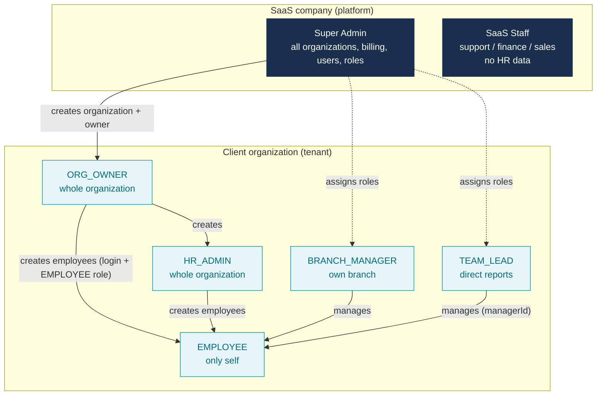

| User type | Role(s) | Uses | Data scope |
|---|---|---|---|
| `SUPER_ADMIN` | platform | Web app | every organization |
| `SAAS_STAFF` | platform role (Support, Finance, Sales) | Web app | platform data only, **no HR data** |
| `ORG_USER` | `ORG_OWNER` | Web app (+ mobile) | `ORGANIZATION` |
| `ORG_USER` | `HR_ADMIN` | Web app (+ mobile) | `ORGANIZATION` |
| `ORG_USER` | `BRANCH_MANAGER` | Mobile + web | `BRANCH` |
| `ORG_USER` | `TEAM_LEAD` | Mobile + web | `TEAM` |
| `ORG_USER` | `EMPLOYEE` | Mobile app | `SELF` |

A user with several roles gets all their permissions and the **widest** scope.

## 2. What each user can do

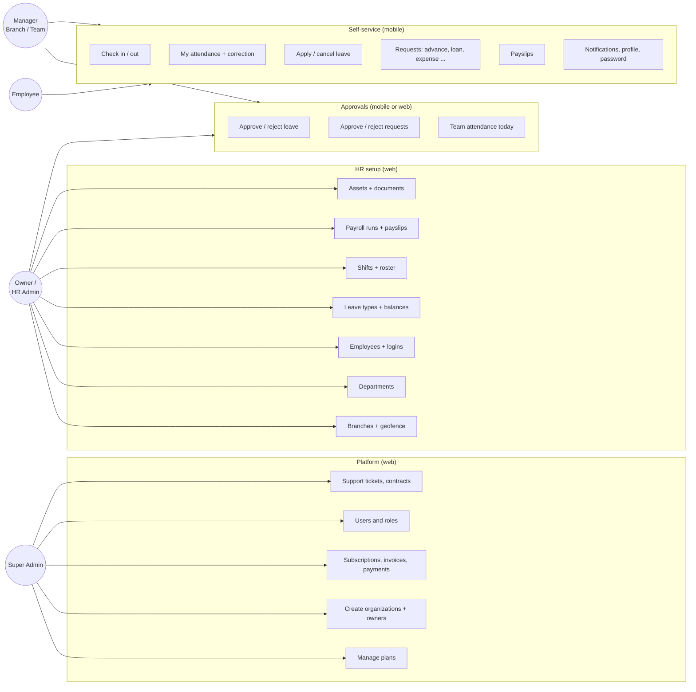

| Action | Super Admin | Owner | HR Admin | Branch Mgr | Team Lead | Employee |
|---|:-:|:-:|:-:|:-:|:-:|:-:|
| Plans, organizations, billing | ✅ | | | | | |
| Users and roles | ✅ | | | | | |
| Branches, departments, employees | ✅* | ✅ | ✅ | view | view | view |
| Leave types, balances, shifts | ✅* | ✅ | ✅ | shifts | view | view |
| Payroll runs | ✅* | ✅ | ✅ (no approve) | | | |
| Check in / apply leave / requests | | ✅ | ✅ | ✅ | ✅ | ✅ |
| Approve leave and requests | ✅* | ✅ | ✅ | ✅ | ✅ | |
| See payslips | ✅* | all | all | branch | team | own |

\* after picking the organization in the web app's top bar. Nobody can approve their own leave or request.

## 3. Who sees which data

Every list the API returns is filtered by the caller's **data scope** (a JWT claim, refreshed at sign-in).

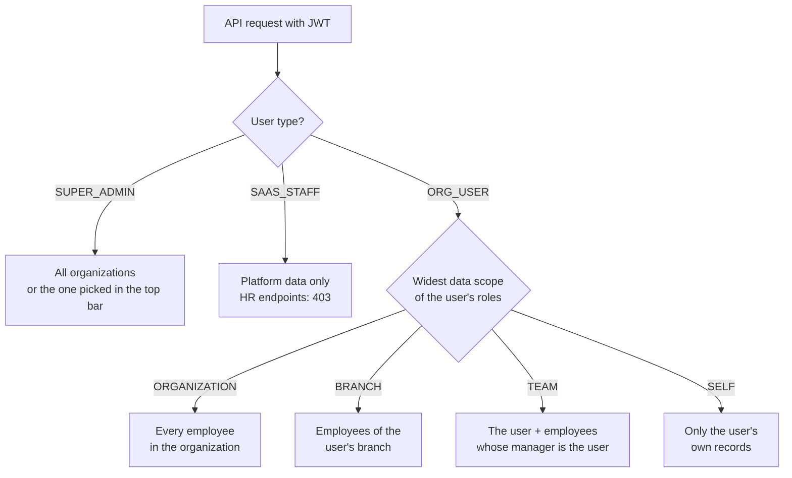

## 4. Setup flow (first time)

What must exist before the apps work. Details for each box are in the [manual](USER_MANUAL.md).

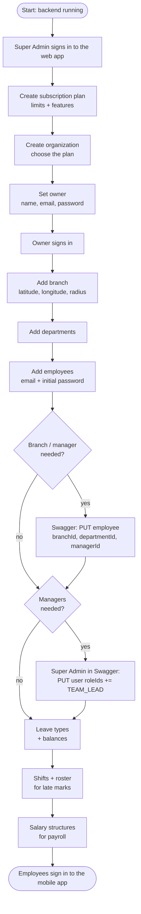

## 5. Mobile app screens

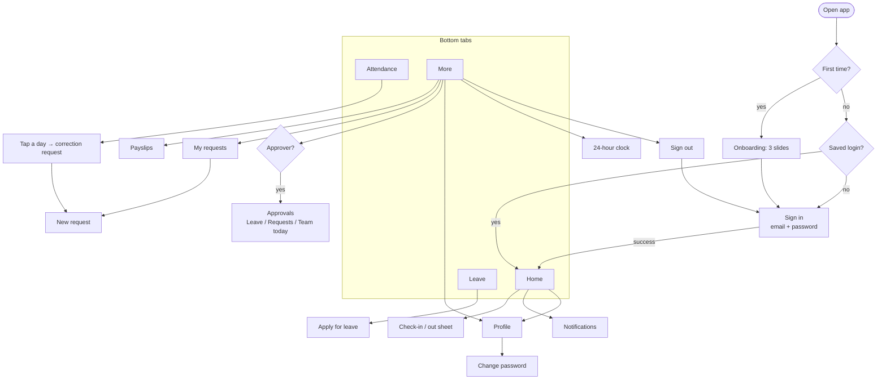

## 6. Check-in / check-out

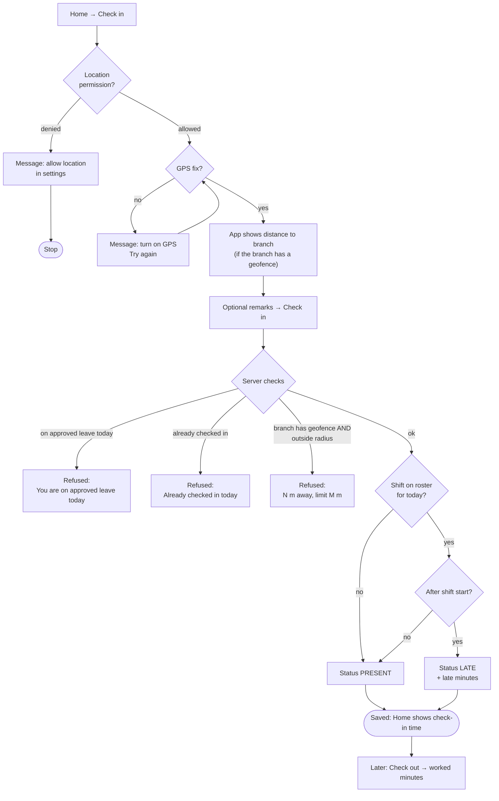

## 7. Leave

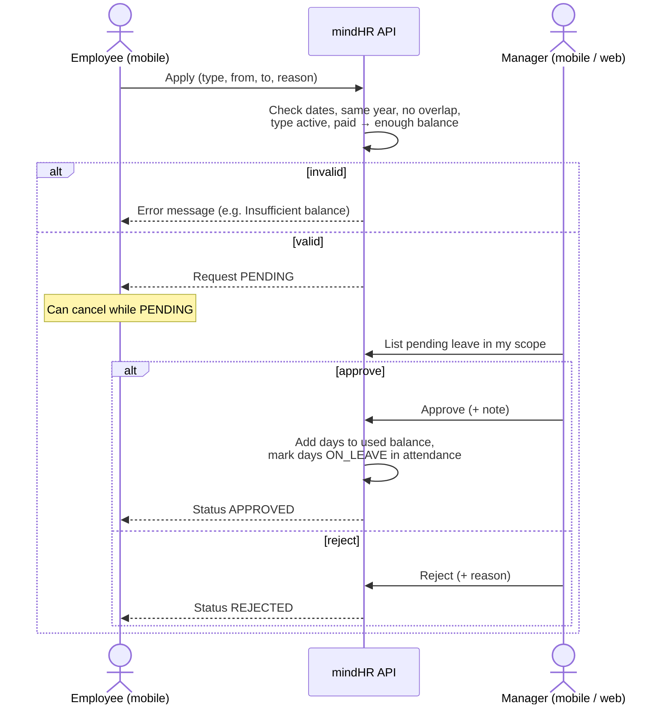

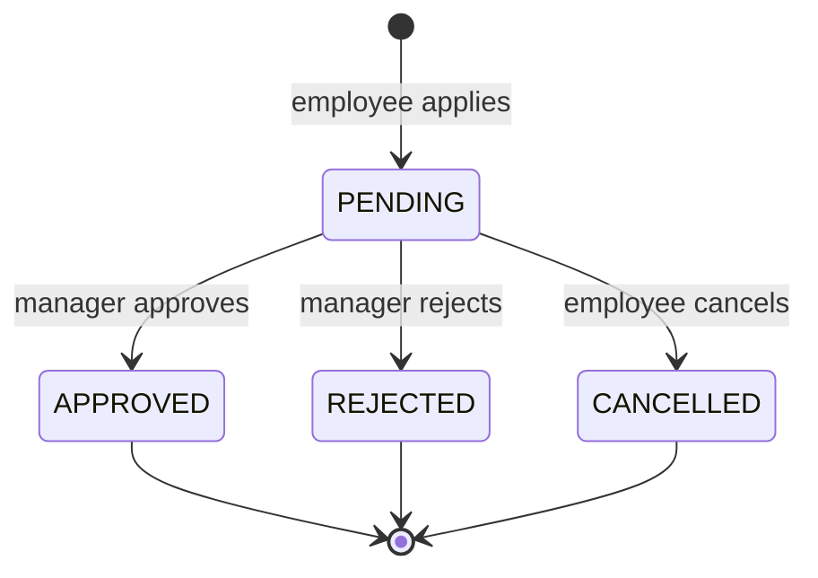

## 8. Requests (advance, loan, expense, correction ...)

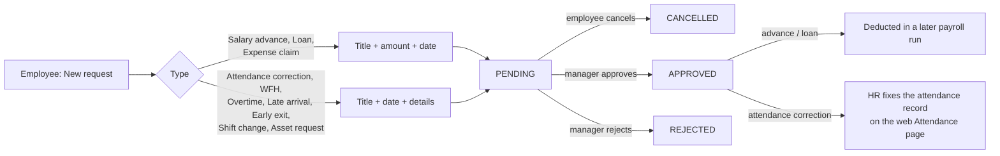

## 9. Payroll

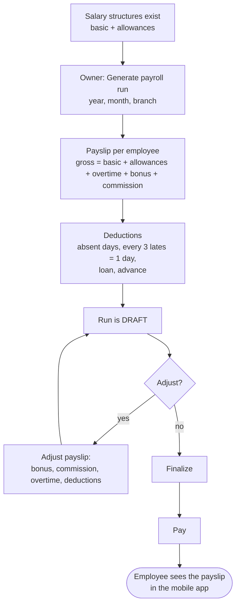

Rules: Friday is the weekly day off; approved leave days are covered; no holiday calendar yet.

## 10. Sign-in and session

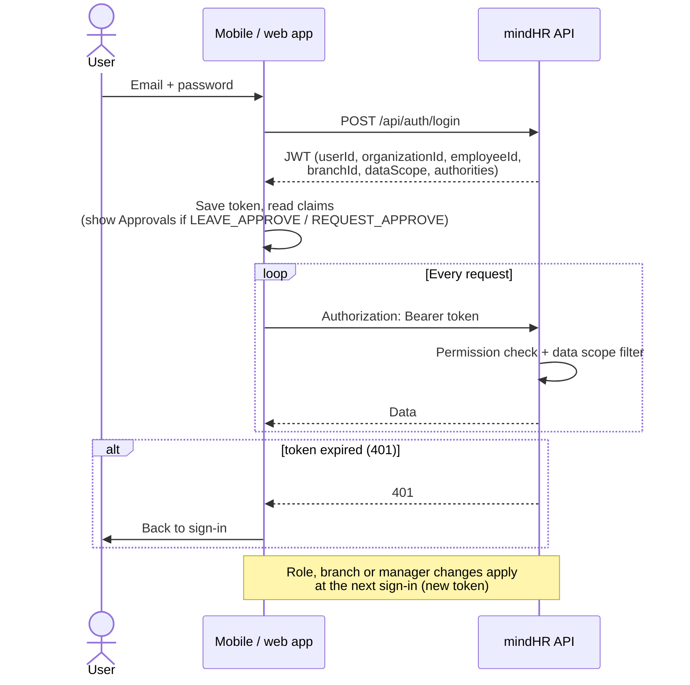
